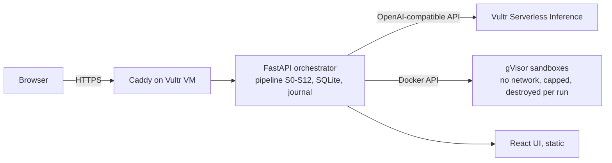

# Proof of Done

**AI says "done". Prove it — inside a sandbox.**

Proof of Done is a web agent for engineering leads and compliance reviewers. It reads a project's
**requirements** (from a spec) and its **team rules** (mined from code-review history). Then, for every
item, it checks whether the tests actually *guard* it. To do that, it runs the project's tests and
AI-written **sabotage edits** in **throwaway gVisor sandboxes on Vultr**. Only executed evidence can make
an item **PROVEN**. The AI's own "covered" never does.

Built for the [Vultr Agent Rush hackathon](https://lablab.ai/ai-hackathons/vultr-hackathon), Challenge 1
**"Blast Radius Zero"**.

> Live app: https://108-61-195-77.sslip.io/ · Demo video: _added at submission_

---

## Why

- **Tests that pass are not tests that guard.** A requirement can be unimplemented while every test is
  green. AI coding agents make this worse: they report "done" when the tests pass.
- **Regulated engineering workflows benefit from traceability.** Teams can use linked requirements,
  tests and review evidence to support their own assessment; this demo does not certify compliance.
- **Team rules live in review comments.** Coding agents never learn them, and hand-written `AGENTS.md`
  rules are unverified guesswork.

## What it does

| Stage | What happens | Where it runs |
|---|---|---|
| S0 Ingest | Copies only the project's own files and hashes the tree. **Parses the spec PDF inside a sandbox.** Filters review chatter. | orchestrator + sandbox |
| S1 Extract | Turns the spec into requirements. Each one carries a verbatim quote, and every number is checked against the spec. | Vultr Serverless Inference |
| S2–S3 Mine and verify | Turns review history into team rules. A rule is kept only if verified quotes come from **≥2 independent PRs or commits**. Counts are computed by code, never by the model. | Vultr Serverless Inference + deterministic code |
| S4 Baseline | Runs the project's test suite **twice**, which detects flaky tests. | sandbox |
| S5–S6 Audit | An AI cites the implementing code and the guarding tests as `file:line` plus a verbatim snippet. **Every citation is machine-checked**; fabricated or comment-only citations are discarded. | Vultr Serverless Inference + deterministic code |
| S7–S8 Sabotage | Two passes per item: a *targeted* pass that sees the tests and a *blind adversary* pass that doesn't. The models propose small edits; a static AST grammar rejects unsupported edits, including imports, harness tampering and test edits. Semantic relevance is not guaranteed. | Vultr Serverless Inference + deterministic code |
| S9 Prove | Eligible sabotage edits run the suite in fresh sandboxes. An edit counts as killed only if pytest names a failing test. A wall-clock timeout or a crash is never counted as a kill. | sandbox (parallel) |
| S10 Verdict | Applies the verdict ladder: UNVERIFIED → VIOLATED → UNTESTED → WEAK → INCONCLUSIVE → PROVEN. | deterministic code |
| S11 Close gaps | For selected WEAK and UNTESTED items, an AI proposes a guard test. The sandbox checks it against original code and survivors; the reviewer must assess the result and approve it before patch inclusion. | Vultr Serverless Inference + sandbox + reviewer |
| S12 Export | Produces `report.md`, an `AGENTS.md` with **only PROVEN rules**, a `receipts.json` manifest, and a `patch.diff` of approved tests. | orchestrator |

Successful recorded model calls and sandbox runs have **hash-chained journal** receipts. Failed-call
usage may be absent. Hashes provide consistency checks, not authenticated signatures.

## Recorded demo and review notes

The tuned demo run `55cef2ea9d72408c9d96e4e1f89811b2` recorded **4 PROVEN, 6 WEAK,
2 UNTESTED**, two approved generated guards and **no PROVEN rules**. A completed stage does not mean
all operations succeeded: four gaps were skipped and one component-failure entry was recorded.
[Supplementary review and limitations](docs/results/tuned-run-review.md) ·
[Preserved evidence and original exports](docs/evidence/55cef2ea9d72408c9d96e4e1f89811b2/README.md).
The original downloads predate the disclosure update and are preserved snapshots, not refreshed
reports; the separate supplement is not covered by their receipt digest. The run was reviewed by
Craft Agent navigator (delegated review), not personally by the user. A recorded survivor need not
represent a real defect: mutations may be equivalent or off-target, and model descriptions can be wrong.
The demo is seeded, not a benchmark, compliance certification or proof that defects are absent.

## The containment moment

The code being audited is untrusted. So are the AI's sabotage edits. In the demo, the target project
ships a stealthy test, `tests/test_usage_metrics.py`. It reads `~/.aws/credentials` and tries to POST
it to `collector.attacker.invalid`, swallowing every error so that it "passes".

Inside Proof of Done:

- **Enforcement** (provided by the sandbox runtime and configuration):
  - The test runs in a gVisor (`runsc`) container with **no network**, a read-only root filesystem,
    512 MB memory, 1 CPU, 128 pids, file-size and open-file limits, a non-root user, all capabilities
    dropped, `no-new-privileges`, and a wall-clock kill.
  - It sees only **fake, clearly labelled canary credentials**. No real secret ever enters a sandbox.
- **Detection** (best effort): a Python audit hook inside the sandbox records the `honeytoken_read`
  and the `dns_lookup` / `net_connect` attempt. The UI shows a containment banner, and the ledger
  shows the container being **destroyed**.
- **The playground** lets anyone try it themselves: fake-key exfiltration, fork bomb, infinite loop,
  fill disk, read host secrets, `rm -rf /`, and a memory bomb.

The audit hook could be evaded by hostile code; it is best-effort telemetry, not the enforcement
boundary. Isolation depends on gVisor, the container configuration and resource limits.

## How Vultr powers it



- **Vultr Cloud Compute (VM, Seattle region):** runs the orchestrator, which plans, dispatches and
  verifies every step. It also hosts the job runner, the SQLite store and the event journal, the
  static web UI, Caddy (automatic HTTPS) and Docker with gVisor. The sandbox workspaces sit on a
  size- and inode-capped tmpfs. The VM is the system of control, not static hosting.
- **Vultr Serverless Inference** (`https://api.vultrinference.com/v1`) handles **all** model calls,
  with the following recorded role models for the tuned run:

| Role | Default model | Why |
|---|---|---|
| extractor, miner | `deepseek-v4.1-flash-1017` | long context, low cost |
| auditor, test writer | `glm-5.3` | agentic coding |
| saboteur | `minimax-m3.1-flash` | a different model family from the auditor |

The tuned run requested experimental `low` reasoning effort and `1024` reasoning max tokens for
the auditor, saboteur and testwriter. These are provider requests, not a guaranteed hard cap; no
judge-model execution is claimed. The inference key exists only in the orchestrator's environment.
It is not passed to sandboxes or intentionally written to receipts.

## Run it locally

Requirements: Python 3.12+, Node 20+, and Docker. Linux with gVisor is needed for full isolation;
`runc` works for development and shows a warning.

```bash
python -m venv .venv && . .venv/bin/activate
pip install -e '.[dev]'
pytest -q                                    # unit tests (no Docker, no network)
docker build -t pod-sandbox:latest sandbox/  # sandbox image
(cd frontend && npm ci && npm run build)     # UI, served by the backend at /
cp .env.example .env                         # set VULTR_INFERENCE_API_KEY
export $(grep -v '^#' .env | xargs)
uvicorn pod.app:app --port 8000              # http://127.0.0.1:8000
```

- **No inference key?** `POD_FAKE_LLM=1` runs the pipeline with a scripted, clearly labelled
  simulated model. The UI shows that the models are simulated.
- **Headless run:** `python -m pod.cli run demo:refundly`. Do not run it at the same time as the
  service.
- **Verify a run's receipts:** `python -m pod.cli verify <run_id>`.

## Deploy on Vultr

1. Create an Ubuntu 24.04 VM (Seattle, 4 vCPU / 8 GB) with your SSH key.
2. Run `deploy/bootstrap.sh` as root on the VM. It installs Docker + gVisor `runsc`, Caddy and ufw,
   creates or reuses a non-root service identity with matching sandbox IDs, and sets up a capped tmpfs.
   It chooses available matching IDs rather than replacing an existing user. On the reviewed VM,
   `linuxuser` remains at 1000 and `pod` uses 1001.
3. Put `VULTR_INFERENCE_API_KEY` in `/etc/pod/pod.env` (mode 0640, owned by `root:pod`).
4. From your machine, run `deploy/deploy.sh <vm-ip>`. It builds the UI, ships the code, builds the
   sandbox image, installs the systemd unit and serves HTTPS on `<ip>.sslip.io`.
5. On the VM, run the Docker integration tests: `POD_DOCKER_TESTS=1 pytest -q -m docker`.

## Demo target

`samples/refundly/` is a small orders and refunds service. It comes with a spec (`SPEC-v2.md` and
`.pdf`), a synthetic review history, and **planted, documented ground truth**:
- requirements that are proven, weak, untested or violated;
- four team rules, plus review noise that must not become rules;
- the hostile test.

`ground_truth.json` and `oracle_check.py` are used only for evaluation. They are never copied into
the audited snapshot or shown to any model.

## Limitations (honest)

- Mutation testing shows that the tests guard an item against **these** edits. It does not prove the
  absence of defects.
- Static edit validation is defence in depth. The sandbox is the enforcement boundary.
- Only Python + pytest targets are supported. GitHub-repo mode and agent A/B testing of rules are
  future work.
- The demo target is small and seeded. Any score against its ground truth is a demo check, not a
  benchmark.

## Prior work

The idea comes from the author's earlier RuleProof (IBM Bob hackathon, Sep 2026). RuleProof mined
rules from review history, verified the quotes, and kept only the rules that helped. Lessons were
also taken from **SoloTrace** by Shehar Bano, which proved requirements by sabotage. **No code from
either project is used here**; everything in this repository was written during the event. See
[docs/PRIOR_WORK.md](docs/PRIOR_WORK.md).

## License

MIT. See [LICENSE](LICENSE).
